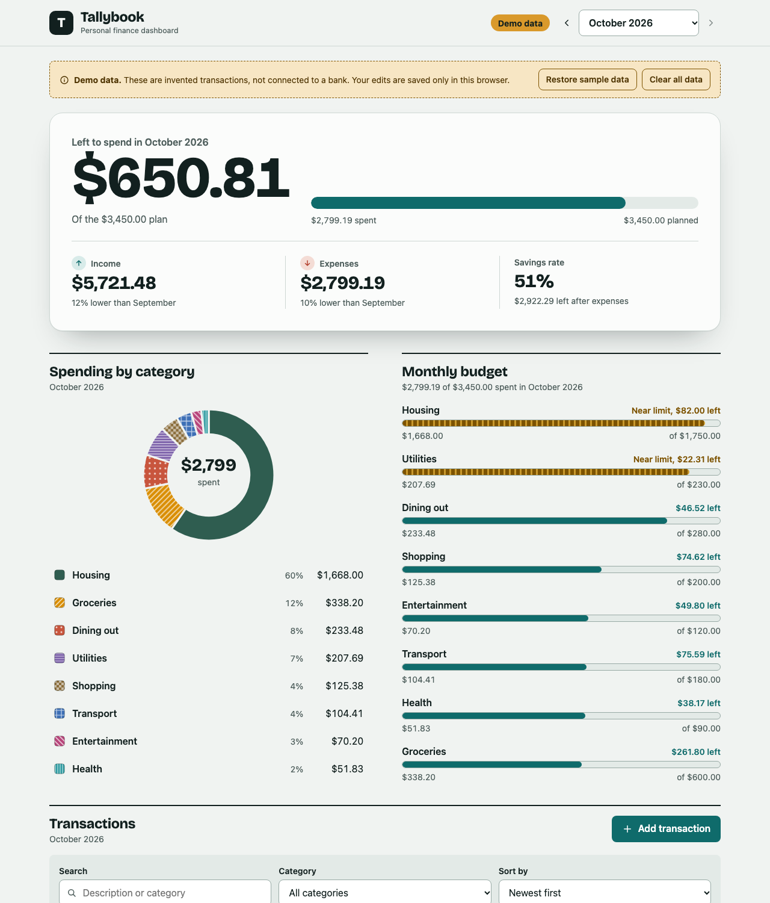

# Tallybook

A personal finance dashboard built as a portfolio project. It shows a monthly overview, a spending breakdown, a budget comparison and a searchable transaction list, all from sample data. There is no sign-up and no bank connection: open it and try it.

It is a static React app (Vite + TypeScript) that deploys to GitHub Pages. It organizes and visualizes sample or manually entered data. It does not connect to banks, process payments, or give financial advice.



## Features

- Monthly overview: a hero showing how much of the plan is left, with income, expenses and savings rate (compared with the previous month) underneath
- Spending breakdown: donut chart plus a legend with amounts and percentages (slices also use textures, so they do not rely on color alone). Choosing a legend item filters the transaction list.
- Monthly budget: planned vs actual per category, with text and pattern cues for "near limit" and "over budget"
- Transactions: search, category filter, sorting, income/expense indicators (icon, sign and color)
- Add, edit and delete transactions with validation
- Month selector (six months of sample data)
- Empty states, confirm dialogs and error messages
- A visible "Demo data" badge and notice

## Run locally

Requires Node.js 20 or newer.

```bash
npm install
npm run dev
```

Open the URL printed in the terminal (usually http://localhost:5173).

Other scripts:

```bash
npm run lint        # oxlint
npm run typecheck   # tsc
npm test            # vitest unit tests
npm run build       # typecheck, then build the static site into dist/
npm run preview     # serve dist/ locally to check the production build
```

## Build the static site

```bash
npm run build
```

The output is in `dist/`. It is plain HTML, CSS and JavaScript and can be hosted on any static host.

## Deploy to GitHub Pages

A workflow is included at `.github/workflows/deploy.yml`. It lints, runs the tests, builds and publishes on every push to `main`.

1. Push this project to a GitHub repository.
2. In the repository, open **Settings > Pages** and set **Source** to **GitHub Actions**.
3. Push to `main` (or run the workflow manually from the Actions tab). The site appears at `https://<your-user>.github.io/<repository-name>/`.

### Base path

Project sites on GitHub Pages live under a subpath (`/<repository-name>/`). By default the build uses relative URLs (`base: './'`), which work under any subpath, so you usually need to do nothing. The app has no client-side routing, which is what makes this safe.

If you want an absolute base path (for example when using a custom setup), set `VITE_BASE_PATH` at build time:

```bash
VITE_BASE_PATH=/my-repo/ npm run build
```

In GitHub Actions, add a repository variable named `VITE_BASE_PATH` (Settings > Secrets and variables > Actions > Variables). Nothing in this project hard-codes a repository name or URL.

## Demo mode

Demo mode is the default. The sample transactions are generated in code (`src/data/demoData.ts`) with a seeded generator, so everyone sees the same data.

- Any transaction you add, edit or delete is saved in your browser's local storage (key `tallybook:demo:v1`). It never leaves your device.
- **Restore sample data** (in the Demo data notice) replaces everything with the original sample data.
- **Clear all data** removes every transaction so you can see the empty state. Restore brings the samples back.
- Clearing your browser's site data also resets the demo.

## Project structure

```
src/
  data/         Sample categories, budgets and the transaction generator
  lib/          Pure helpers: calculations, validation, money and date formatting
  services/     Data access: the repository interface and the local demo implementation
  hooks/        useFinanceData: loads data from the repository into React state
  components/   UI components (dashboard panels, chart, form, dialogs)
  styles/       Design tokens, base styles, component styles
  App.tsx       Page shell, month and dialog state
docs/
  api-boundary.md   The contract for a future Rails JSON API
```

Components never touch local storage directly. They call `useFinanceData`, which talks to a `FinanceRepository`. That interface is the seam for a future backend.

## Future Rails API

See [docs/api-boundary.md](docs/api-boundary.md) for the interface, the expected endpoints and the steps to switch from the local demo repository to an API.

## Design notes

- Money is stored as integer cents and formatted with `Intl.NumberFormat`. Dates are ISO strings formatted in UTC so time zones never shift a day.
- The chart is a small hand-written SVG. A chart library was not needed for one donut chart, and this keeps the bundle small and the accessibility under control.
- Styling is plain CSS with design tokens (`src/styles/tokens.css`) instead of a utility framework.
- Design: one raised hero answers "how much of the plan is left"; everything else is flat sections divided by rules. Headings and figures use Bricolage Grotesque (self-hosted through `@fontsource-variable`, so no external font requests); body text uses the system font.
